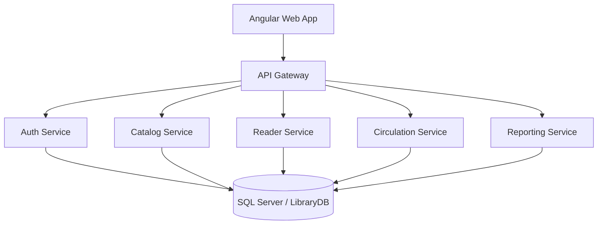
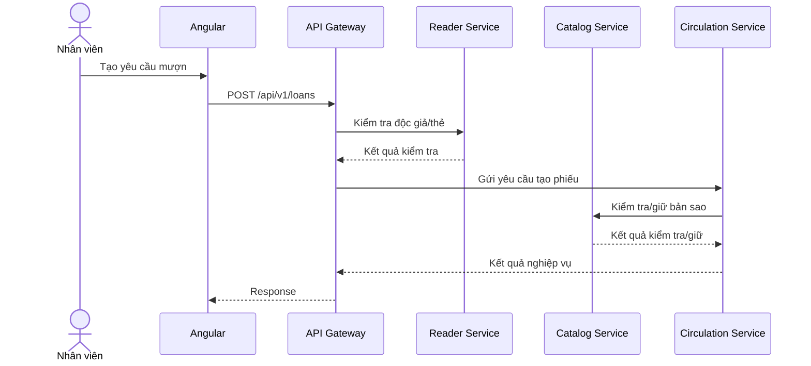

# 2. Kiến trúc hệ thống SOA

## 2.1. Nguyên tắc

- Phân chia theo năng lực nghiệp vụ.
- Mỗi service sở hữu logic và dữ liệu thuộc phạm vi của mình.
- Service trao đổi với nhau qua API được công bố.
- Frontend chỉ gọi API Gateway.
- Dùng API contract chung để phối hợp frontend/backend.
- Không truy cập trực tiếp database của service khác.
- Có thể dùng chung một SQL Server instance/database trong môi trường đồ án, nhưng vẫn tách schema và quyền sở hữu logic.

## 2.2. Sơ đồ thành phần



Reporting Service lấy dữ liệu qua API hoặc read model/snapshot được thiết kế riêng. Không truy vấn trực tiếp các bảng nghiệp vụ của service khác.

## 2.3. Trách nhiệm service

| Service | Trách nhiệm | Schema sở hữu dự kiến |
|---|---|---|
| API Gateway | Điểm vào backend, định tuyến, xử lý chung, chuyển tiếp token | Không có dữ liệu nghiệp vụ |
| Auth | Đăng nhập, tài khoản, vai trò, phân quyền, cấu hình và audit liên quan tài khoản | `auth` |
| Catalog | Đầu sách, tác giả, thể loại, bản sao, tình trạng, kiểm kê thủ công | `catalog` |
| Reader | Hồ sơ độc giả, loại độc giả, trạng thái thẻ | `reader` |
| Circulation | Phiếu mượn, trả, đặt giữ, gia hạn, vi phạm, tiền phạt | `circulation` |
| Reporting | Tổng hợp số liệu/báo cáo; chỉ tạo bảng snapshot nếu cần | `reporting` |

## 2.4. Phân định các nghiệp vụ dễ nhầm

- **Catalog** quản lý trạng thái vật lý của bản sao: sẵn sàng, đang mượn, hư hỏng, mất, đang giữ (nếu nhóm chọn mô hình này).
- **Circulation** quản lý trạng thái giao dịch: phiếu mượn, yêu cầu đặt giữ, yêu cầu gia hạn, vi phạm và khoản phạt.
- **Reader** là nguồn dữ liệu chính của hồ sơ độc giả và trạng thái thẻ.
- **Auth** là nguồn dữ liệu chính của thông tin đăng nhập và vai trò.
- **Audit/log** có thể được phát sinh tại nhiều service; quản trị viên xem thông tin qua chức năng quản trị/tổng hợp. Cần chốt nơi lưu và cách tập trung log.

## 2.5. Giao tiếp

- Frontend → Gateway: HTTP/JSON.
- Gateway → service: REST nội bộ.
- Prefix API công khai: `/api/v1`.
- Token: `Authorization: Bearer <access_token>` khi dùng JWT.
- Mỗi request liên service cần timeout, xử lý lỗi và request/correlation ID.
- Không truyền credentials trong query string.

## 2.6. Luồng mượn sách



Cần chốt service điều phối use case và cách xử lý khi một bước thành công nhưng bước sau thất bại.

## 2.7. Luồng đặt giữ và gia hạn

Đặt giữ:
1. Độc giả gửi yêu cầu đặt giữ qua Gateway.
2. Circulation kiểm tra độc giả và điều kiện nghiệp vụ thông qua Reader/Catalog khi cần.
3. Circulation tạo yêu cầu và quản lý trạng thái/hàng đợi.
4. Khi bản sao khả dụng, quy trình thông báo/duyệt/nhận sách được thực hiện theo chính sách nhóm chốt.

Gia hạn:
1. Độc giả gửi yêu cầu gia hạn cho lượt mượn.
2. Circulation kiểm tra trạng thái lượt mượn, số lần gia hạn và yêu cầu đặt giữ liên quan.
3. Nếu cần, Circulation kiểm tra thông tin liên quan từ Catalog.
4. Yêu cầu được tự động chấp thuận hoặc chờ nhân viên duyệt theo chính sách cuối cùng.

## 2.8. Luồng kiểm kê

1. Nhân viên tạo đợt kiểm kê tại Catalog.
2. Ghi nhận kết quả thực tế cho từng bản sao hoặc nhóm bản sao.
3. Hệ thống đối chiếu dữ liệu hệ thống với kết quả thực tế.
4. Nhân viên xác nhận chênh lệch, cập nhật tình trạng bản sao theo quyền.
5. Hoàn tất đợt kiểm kê và lưu lịch sử.

Kiểm kê trong phạm vi đồ án là thủ công; không mặc định có RFID hoặc thiết bị tự động.

## 2.9. Nhất quán dữ liệu liên service

Một transaction SQL thông thường không tự động bảo đảm tính nguyên tử qua nhiều service. Với mượn sách, Circulation và Catalog có thể cần phối hợp.

Đề xuất:
- Dùng thao tác hold/confirm/release hoặc một cơ chế đặt trạng thái tương đương.
- Dùng request ID/idempotency key để tránh tạo giao dịch trùng khi retry.
- Nếu tạo phiếu thất bại sau khi giữ bản sao, gọi thao tác giải phóng.
- Ghi log các bước và hỗ trợ xử lý trạng thái trung gian.

Đây là thiết kế cần nhóm chốt, không giả định đã triển khai Saga đầy đủ.

## 2.10. Bảo mật và audit

- Auth xác thực thông tin đăng nhập và cấp token.
- Gateway kiểm tra token hoặc chuyển tiếp đến service theo thiết kế.
- Service vẫn kiểm tra quyền đối với thao tác nhạy cảm.
- Lưu log đăng nhập và thao tác quan trọng nhưng không ghi mật khẩu/token.
- Chỉ quản trị viên hoặc vai trò được cấp quyền mới xem log.
- Dùng HTTPS khi triển khai ngoài môi trường local.

## 2.11. Sơ đồ triển khai local

```text
Windows Developer Machine
├── Angular :4200
├── API Gateway :3000
├── Auth Service :3001
├── Catalog Service :3002
├── Reader Service :3003
├── Circulation Service :3004
├── Reporting Service :3005
└── Docker Desktop
    └── SQL Server :1433
```
