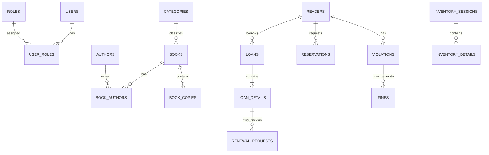

# 3. Thiết kế cơ sở dữ liệu

## 3.1. Định hướng

Môi trường phát triển dùng một SQL Server database tên `LibraryDB`, chia schema theo quyền sở hữu của service. Đây là cách triển khai thuận tiện cho đồ án; ranh giới dữ liệu vẫn phải được tôn trọng ở cấp ứng dụng.

| Schema | Service sở hữu |
|---|---|
| `auth` | Auth Service |
| `catalog` | Catalog Service |
| `reader` | Reader Service |
| `circulation` | Circulation Service |
| `reporting` | Reporting Service nếu cần lưu snapshot |

## 3.2. Bảng dự kiến

### 3.2.1. Auth schema

| Bảng | Mục đích | Cột chính dự kiến |
|---|---|---|
| `users` | Tài khoản | `user_id`, `username`, `password_hash`, `is_active`, timestamps |
| `roles` | Vai trò | `role_id`, `role_name` |
| `user_roles` | Liên kết tài khoản-vai trò | `user_id`, `role_id` |
| `system_settings` | Thông số cấu hình được phép quản trị | `setting_id`, `setting_key`, `setting_value` |
| `audit_logs` | Nhật ký thao tác quản trị/đăng nhập nếu chọn lưu tại Auth | `log_id`, `user_id`, `action`, `resource`, `created_at`, `request_id` |

Audit log có thể được tập trung theo một service logging riêng trong tương lai; với phạm vi hiện tại có thể lưu log quan trọng theo thiết kế thống nhất. Không lưu password/token.

### 3.2.2. Catalog schema

| Bảng | Mục đích | Cột chính dự kiến |
|---|---|---|
| `categories` | Thể loại | `category_id`, `name`, `description` |
| `authors` | Tác giả | `author_id`, `name`, thông tin mô tả |
| `books` | Đầu sách | `book_id`, `isbn`, `title`, `category_id`, metadata |
| `book_authors` | Quan hệ sách-tác giả | `book_id`, `author_id` |
| `book_copies` | Từng bản sao vật lý | `copy_id`, `book_id`, `copy_code`, `status` |
| `inventory_sessions` | Đợt kiểm kê | `session_id`, `created_by`, `started_at`, `completed_at`, `status` |
| `inventory_details` | Kết quả kiểm kê | `detail_id`, `session_id`, `copy_id`, `system_status`, `actual_status`, `note` |

Có thể cần bổ sung trường số lượng thực tế/chênh lệch hoặc bảng ghi nhận sự kiện kiểm kê tùy cách nhóm thiết kế.

### 3.2.3. Reader schema

| Bảng | Mục đích | Cột chính dự kiến |
|---|---|---|
| `readers` | Hồ sơ độc giả | `reader_id`, `user_id` (ID tham chiếu logic), `reader_code`, `full_name`, `contact_info`, `reader_type`, `card_status` |

`user_id` là ID từ Auth Service nếu nhóm quyết định liên kết tài khoản; không tạo foreign key vật lý xuyên service.

### 3.2.4. Circulation schema

| Bảng | Mục đích | Cột chính dự kiến |
|---|---|---|
| `loans` | Phiếu mượn | `loan_id`, `reader_id`, `created_by`, `borrowed_at`, `due_at`, `status` |
| `loan_details` | Bản sao thuộc phiếu mượn | `loan_detail_id`, `loan_id`, `copy_id`, `returned_at`, `status` |
| `reservations` | Yêu cầu đặt giữ | `reservation_id`, `reader_id`, `book_id` hoặc `copy_id`, `requested_at`, `status`, `queue_position` |
| `renewal_requests` | Yêu cầu gia hạn | `renewal_id`, `loan_detail_id`, `requested_at`, `status`, `reviewed_by`, `new_due_at` |
| `violations` | Vi phạm | `violation_id`, `reader_id`, `loan_detail_id`, `violation_type`, `description`, `recorded_at` |
| `fines` | Khoản phạt | `fine_id`, `violation_id`, `amount`, `status`, `created_at`, `resolved_at` |

Cần chốt đặt giữ theo đầu sách hay bản sao. Nếu đặt giữ theo đầu sách, `book_id` là định danh tham chiếu logic đến Catalog. Nếu đặt giữ bản sao cụ thể, dùng `copy_id`. Không cần lưu đồng thời cả hai nếu không có lý do nghiệp vụ rõ ràng.

### 3.2.5. Reporting schema

Ban đầu có thể chưa cần bảng. Reporting lấy dữ liệu qua API service. Nếu cần lưu read model/snapshot, định nghĩa bảng và lịch đồng bộ riêng; không đọc trực tiếp schema của service khác.

## 3.3. Quan hệ logic

Sơ đồ là quan hệ nghiệp vụ khái quát. Các ID đi qua ranh giới service là tham chiếu logic, không tạo foreign key vật lý liên service.

## 3.4. Trạng thái đề xuất cần chốt

| Đối tượng | Trạng thái ví dụ |
|---|---|
| Bản sao sách | `AVAILABLE`, `ON_LOAN`, `ON_HOLD`, `DAMAGED`, `LOST` |
| Độc giả/thẻ | `ACTIVE`, `SUSPENDED`, `EXPIRED` |
| Phiếu mượn | `ACTIVE`, `COMPLETED`, `OVERDUE`, `CANCELLED` |
| Đặt giữ | `PENDING`, `READY`, `FULFILLED`, `CANCELLED`, `EXPIRED` |
| Gia hạn | `PENDING`, `APPROVED`, `REJECTED` |
| Kiểm kê | `IN_PROGRESS`, `COMPLETED`, `CANCELLED` |
| Tiền phạt | `UNPAID`, `PAID`, `WAIVED` |

Đây là giá trị minh họa để thiết kế, không phải quy định cuối cùng. Cần thống nhất enum/lookup table và chuyển đổi trạng thái hợp lệ.

## 3.5. Quy tắc dữ liệu

- Chọn kiểu khóa chính thống nhất (`BIGINT IDENTITY` hoặc `UNIQUEIDENTIFIER`).
- Chuẩn hóa `created_at`, `updated_at` và quy ước timezone.
- Unique constraint cho username, reader_code, copy_code; ISBN tùy quy tắc dữ liệu.
- Index các trường thường tìm kiếm/lọc như ISBN, title, status, reader_id, due_at.
- Không xóa cứng dữ liệu giao dịch đã phát sinh lịch sử nếu làm mất khả năng kiểm toán.
- Định nghĩa rõ soft delete/disable cho đầu sách, tài khoản và độc giả.

## 3.6. Quyền sở hữu và liên kết

- `circulation.reader_id` tham chiếu logic đến Reader Service.
- `circulation.book_id`/`copy_id` tham chiếu logic đến Catalog Service.
- `reader.user_id` tham chiếu logic đến Auth Service nếu có liên kết.
- Việc xác minh ID được thực hiện qua API của service sở hữu dữ liệu hoặc quy trình tích hợp đã thống nhất.

## 3.7. Migration

- Mỗi service quản lý migration riêng.
- TypeORM `synchronize: false`.
- Migration được commit cùng thay đổi entity.
- Không sửa migration đã chạy trên môi trường dùng chung; tạo migration mới.
- Seed data tách khỏi migration cấu trúc và nên chạy lặp an toàn.
- Thay đổi contract dữ liệu liên service cần được trao đổi trước.

## 3.8. Các quyết định còn mở

1. Kiểu ID.
2. Đặt giữ theo đầu sách hay bản sao.
3. Cách xếp hàng và thời hạn nhận sách đặt giữ.
4. Tự động duyệt hay nhân viên duyệt gia hạn.
5. Trạng thái và quy tắc chuyển trạng thái.
6. Mô hình lưu audit log.
7. Có cần snapshot/reporting tables hay không.
